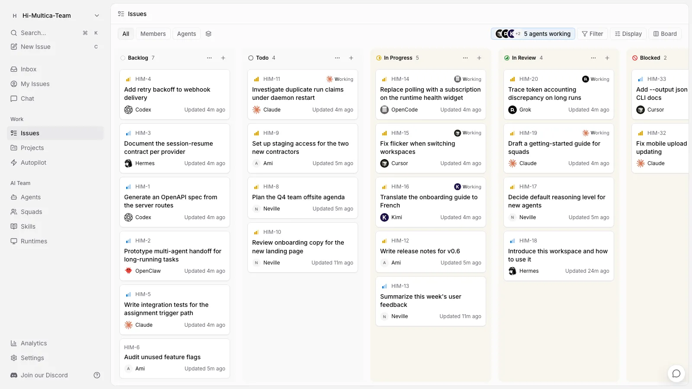

> **公司內網繁中版（zh-tw）**
>
> 本分支連線 s90：`https://10.1.24.90:45671`。請使用以下繁中版入口；下方原版說明中的官方安裝器不適用這套部署。
>
> - [無 App 的 CLI／daemon 安裝 script](scripts/install-zh-tw.sh)：固定 `0.4.41-zh-tw.6` 及下載校驗碼，安裝到 `~/.local/bin/multica`，不預設具名 profile，自動處理 CA／URL。
> - [完整安裝、Gmail 登入、服務管理與重建說明](docs/lan-installation.zh-tw.md)。
> - [繁中版 Releases](https://github.com/hyc5566/multica/releases)：Mac App 目前只提供 Apple Silicon／arm64。
>
> **發布狀態：[0.4.41-zh-tw.6 內網驗收版](https://github.com/hyc5566/multica/releases/tag/zh-tw-v0.4.41-zh-tw.6) 已提供下載（pre-release）。s90 Server／Web 已升級，Gmail 驗證碼為 15 分鐘；新使用者完整安裝與第一個任務仍待真人驗收。**
>
> 已取得本 repo 後，執行 `bash scripts/install-zh-tw.sh --login`；Linux 若要 systemd user service，改用 `--service`。安裝器會提示輸入個人 API token，請勿將 token 放在指令列或留言。既有安裝不會被靜默覆寫。
>
> 安裝器原始模板與建置入口：[install.sh.in](scripts/lan-release/install.sh.in)、[build.sh](scripts/lan-release/build.sh)。更新固定版 script 時，必須同步該版本下載 URL 與校驗碼。

<div align="center">

<picture>
  <source media="(prefers-reduced-motion: reduce) and (prefers-color-scheme: dark)" srcset="docs/assets/logo-dark.svg">
  <source media="(prefers-reduced-motion: reduce)" srcset="docs/assets/logo-light.svg">
  <source media="(prefers-color-scheme: dark)" srcset="docs/assets/logo-dark.gif">
  
</picture>

**Agent，也在看板上。**

Multica 是原始碼可取得的團隊工作區。你可以像分派工作給同事一樣，把任務交給 AI 程式開發 Agent；Agent 會主動接手、回報進度、遇到阻礙時提出，完成後交付結果供你檢查。可自行架設，支援已安裝的 Agent CLI，不繫結廠商。

[](https://github.com/multica-ai/multica/actions/workflows/ci.yml)
[](https://github.com/multica-ai/multica/releases)
[](https://github.com/multica-ai/multica/stargazers)
[](https://discord.gg/W8gYBn226t)

<p align="center">
  <a href="https://www.star-history.com/multica-ai/multica">
    <picture>
      <source media="(prefers-color-scheme: dark)" srcset="https://api.star-history.com/badge?repo=multica-ai/multica&amp;type=rank&amp;theme=dark" />
      <source media="(prefers-color-scheme: light)" srcset="https://api.star-history.com/badge?repo=multica-ai/multica&amp;type=rank" />
      
    </picture>
    <picture>
      <source media="(prefers-color-scheme: dark)" srcset="https://api.star-history.com/badge?repo=multica-ai/multica&amp;type=trending&amp;theme=dark" />
      <source media="(prefers-color-scheme: light)" srcset="https://api.star-history.com/badge?repo=multica-ai/multica&amp;type=trending" />
      
    </picture>
  </a>
</p>

[官網](https://multica.ai) · [文件](https://multica.ai/docs/zh) · [快速開始](https://multica.ai/docs/zh/cloud-quickstart) · [下載](https://multica.ai/download) · [願景](VISION.zh.md) · [自託管](https://multica.ai/docs/zh/self-host-quickstart) · [Discord](https://discord.gg/W8gYBn226t) · [X](https://x.com/MulticaAI)

**[English](README.md) | 簡體中文 | [日本語](README.ja.md)**

</div>

<p align="center">
  
</p>

<p align="center">
  <sub><em>你的下一批員工，不是人類。</em></sub>
</p>

---

## Multica 是什麼

你手上已經同時開著 Claude Code、Codex，還有另外三個 Agent。每一個都關在自己的終端機分頁裡，工作階段
一關就什麼都不記得，同一段上下文你今天已經講到第四遍。結果是 Agent 越加越多，你越忙。

Multica 把這些 Agent 和你的隊友放進同一個工作區。任務派給 Agent，它自己接手，在你自己的機器上跑，
邊做邊評論，做完挪到稽核中等你驗收。從最初的想法，到中間的每一次執行、每一個決定，再到最後的
diff，全都掛在同一個任務下——沒人需要重新捋一遍上下文，也沒有任何東西能不經人點頭就上線。

---

## 組一支隊伍

*Claude Code、Codex、Cursor、Kimi——不用挑一個，全都招進來。*

<p align="center">
  
</p>

- **[你已經在用的 Agent CLI](#執行時) →** Claude Code、Codex、Cursor、Copilot、Kimi、OpenCode 等等。
- **[Agent 也是隊友](https://multica.ai/docs/zh/agents) →** 起個名字、選個提供方、配臺runtime，它就上了看板，跟其他同事沒兩樣。
- **[小隊](https://multica.ai/docs/zh/squads) →** 人和 Agent 混編成隊，leader 決定誰來接活。
- **[Skills](https://multica.ai/docs/zh/skills) →** 解決過一次的問題沉澱下來，全團隊的 Agent 都能複用。
- **[你自己的runtime](https://multica.ai/docs/zh/daemon-runtimes) →** 它們的"工位"就是你的機器——daemon 跑在你的筆記本或雲主機上，程式碼不出門。

## 把活交出去

*一開始只是任務裡潦草的三句話，最後變成一個 pull request。*

<p align="center">
  
</p>

- **[分配任務](https://multica.ai/docs/zh/assigning-issues) →** 像挑同事一樣挑個 Agent 當負責人，剩下的它自己來。
- **[自動化](https://multica.ai/docs/zh/autopilots) →** 日報、巡檢、週報按 cron 自己跑，不用有人催。
- **[聊天](https://multica.ai/docs/zh/chat) →** 直接問工作區，或者不建任務就把活派出去。
- **[專案](https://multica.ai/docs/zh/projects) →** 把工作歸類，順手掛上 Agent 要用的儲存庫和檔案。

## 看得見，也管得住

*這活哪個 Agent 動過？它到底跑了什麼？花了多少？點開那次執行。*

<p align="center">
  
</p>

- **[執行日誌](https://multica.ai/docs/zh/tasks) →** 每次工具呼叫、命令和報錯都帶時間戳，可以完整回放。
- **執行中插話 →** Agent 幹活時直接回覆，訊息會進到目前這次執行，不用等下一次。目前支援 Claude Code、Codex、Grok 和 Kiro。
- **用量統計 →** 每次執行花了多少，按 Agent、按任務都看得到。
- **[人來驗收](https://multica.ai/docs/zh/issues) →** 活先進入稽核中，不直接進 main。上不上線你說了算。
- **[收件匣](https://multica.ai/docs/zh/inbox) →** 只在 Agent 需要你拍板時提醒你，而不是每一步都來煩你。
- **[重試與逾時](https://multica.ai/docs/zh/tasks#失敗與自動重試) →** 失敗的執行會自己重試，或者停下來告訴你為什麼。

## 整套都歸你

*你的機器、你的 Git 服務、你的規矩——還有一份把 Agent 也算進去的審計記錄。*

- **[整套自行架設](SELF_HOSTING.md) →** 透過 Docker Compose 或 Helm 部署在自己的基礎設施。
- **[Git 服務](https://multica.ai/docs/vcs-integration) →** 支援 GitHub、GitLab、Gitea、Forgejo，也能使用自架服務。
- **[工作區](https://multica.ai/docs/workspaces) →** 依團隊隔離 Agent、任務和設定。
- **[角色](https://multica.ai/docs/members-roles)與[使用權限](https://multica.ai/docs/agents#permissions-and-access) →** 從 owner、admin、member 到個別 Agent 的執行權限。
- **[安全模型](https://multica.ai/docs/security-model) →** 瞭解 Agent 能存取和不能存取的內容。
- **[Slack、飛書/Lark、釘釘、企業微信、Telegram](https://multica.ai/docs/channels) →** 在團隊使用的聊天工具中啟動及追蹤 Agent 工作；飛書新連線目前限中國大陸飛書，釘釘、企業微信和 Telegram 由[社群維護](https://multica.ai/docs/community-maintained)。
- **Web、[桌面版](https://multica.ai/docs/desktop-app)、[行動版](https://multica.ai/docs/mobile-app) →** 支援 macOS、Windows、Linux、iPhone 和 iPad；iOS App 目前須自行從原始碼編譯安裝，尚未上架 App Store。
- **[CLI 與 API](https://multica.ai/docs/cli) →** 介面提供的功能也能透過 CLI 和 API 操作；Agent 使用同一套 CLI 操作 Multica。

---

## 開始使用

- **雲端**——直接在 **[multica.ai](https://multica.ai)** 註冊，不用開啟終端機。
- **桌面版**——下載 **[Multica 桌面版](https://multica.ai/download)**（macOS / Windows / Linux）。開啟它，
  這臺電腦就自動成了一個執行時。
- **自託管**——整套跑在你自己的基礎設施上，見下方。

唯一的前提：跑 Agent 的那臺機器上，得裝好、登入好至少一個[受支援的 Agent CLI](#執行時)——
Claude Code、Codex、Cursor 都行。Multica 負責驅動它們，但不替你安裝。

<details>
<summary><b>整套自託管</b></summary>

<br/>

```bash
curl -fsSL https://raw.githubusercontent.com/multica-ai/multica/main/scripts/install.sh | bash -s -- --with-server
multica setup self-host
```

Windows 上先設 `$env:MULTICA_MODE="with-server"`，再跑 PowerShell 安裝指令碼：
`irm https://raw.githubusercontent.com/multica-ai/multica/main/scripts/install.ps1 | iex`。

這會拉取 GHCR 上的官方映象，需要 Docker。詳見[自託管快速上手](https://multica.ai/docs/zh/self-host-quickstart)。
如果你選的 GHCR 標籤還沒釋出，可以在程式碼目錄裡跑 `make selfhost-build` 兜底。

自託管的服務端每天會傳送一份匿名的部署級快照：只有版本號和分桶計數，不含名稱、內容或任何識別符號。
在 API 服務端設定 `DO_NOT_TRACK=1` 即可關閉——[具體收集哪些資料](https://multica.ai/docs/zh/environment-variables#观测与统计)。

</details>

### 五分鐘跑通第一個 Agent

**1. 接入一臺電腦。** 所謂*runtime*，就是 Agent 幹活用的機器——你的筆記本，或者一臺雲主機。用桌面版，
這一步是自動的：它會註冊好這臺電腦，順便檢測裝了哪些 Agent CLI。用網頁版、或者想再接一臺機器，就
開啟**團隊 → runtime**，點**新增runtime → 其他機器或伺服器**，把彈窗裡的兩條命令粘到那臺機器的終端機裡。

**2. 建立 Agent。** 開啟側邊欄的**團隊**，點 **+**（**新建 Agent**）。選中剛接入的runtime，選一個提供方，
起個名字——或者選**透過 AI 建立**，描述幾句，設定自動生成。這個名字就是它之後在看板和留言裡的身份。

**2. 連線一臺電腦。** *執行環境*就是 Agent 工作的機器，例如筆電或雲端主機。使用桌面版時會自動註冊並偵測已安裝的 Agent CLI；使用網頁版或要再連線一臺機器時，請開啟側邊欄的**執行環境**，選擇**新增電腦**，並在目標機器的終端機執行畫面中的命令。

**3. 建立 Agent。** 開啟側邊欄的**Agent**，選擇**建立 Agent**，挑選剛連線的執行環境和提供方並設定名稱；也可以選擇**透過 AI 建立**並描述需求，讓系統產生設定。

**4. 指派工作。** 建立任務並將 Agent 設為負責人。Agent 會接手工作、在你的機器上執行、回報進度，完成後將任務移至審查狀態。
幹完把任務挪到稽核中。

完整流程：[快速開始](https://multica.ai/docs/zh/cloud-quickstart) · [上手教程](https://multica.ai/docs/zh/tutorial)

---

## 執行時

Multica 不自帶模型。它驅動的是你本來就裝好、登入好的 Agent CLI——目前原始碼支援 31 種——因此切換提供者
只要選擇不同選項，不需要遷移。

| Provider | CLI | Provider | CLI |
| --- | --- | --- | --- |
| Claude Code | `claude` | OpenAI Codex | `codex` |
| Cursor Agent | `cursor-agent` | GitHub Copilot CLI | `copilot` |
| OpenCode | `opencode` | OpenClaw | `openclaw` |
| Hermes | `hermes` | Pi | `pi` |
| Antigravity | `agy` | CodeBuddy | `codebuddy` |
| DevEco Code | `deveco` | Grok | `grok` |
| Kimi | `kimi` | Kiro CLI | `kiro-cli` |
| Qoder CLI | `qodercli` | Qoder CN | `qoderclicn` |
| Qwen Code | `qwen` | QwenPaw | `qwenpaw` |
| Reasonix | `reasonix` | Trae CLI | `traecli` |
| DeepSeek Harness | `dsh` | Oh-My-Pi | `omp` |
| MiniMax Code | `mcode` | Dim | `dim` |
| 華為雲 CodeArts | `codearts` | ZeroClaw | `zeroclaw` |
| Muse Code | `muse` | Devin CLI | `devin` |
| Amp | `amp` | Factory Droid | `droid` |
| ZCode | `zcode` / ZCode Desktop | | |

安裝與登入方式：[安裝 Agent 執行環境](https://multica.ai/docs/install-agent-runtime) · [AI 程式開發工具比較](https://multica.ai/docs/providers)

---

## 文件

| 我想…… | 從這裡看 |
| --- | --- |
| 我想…… | 請參考 |
| --- | --- |
| 讓 Agent 開始工作 | [快速開始](https://multica.ai/docs/cloud-quickstart) · [上手教學](https://multica.ai/docs/tutorial) |
| 瞭解系統運作方式 | [核心概念](https://multica.ai/docs/concepts) · [Multica 如何運作](https://multica.ai/docs/how-multica-works) |
| 建立和設定 Agent | [Agent](https://multica.ai/docs/agents) · [建立 Agent](https://multica.ai/docs/agents-create) · [Skills](https://multica.ai/docs/skills) |
| 把工作交給 Agent | [觸發 Agent](https://multica.ai/docs/triggering-agents) · [指派任務](https://multica.ai/docs/assigning-issues) · [提及](https://multica.ai/docs/mentioning-agents) |
| 連線自己的機器 | [Daemon 與執行環境](https://multica.ai/docs/daemon-runtimes) · [安裝 Agent 執行環境](https://multica.ai/docs/install-agent-runtime) |
| 整合 Git 和聊天工具 | [GitHub](https://multica.ai/docs/github-integration) · [自架 Git](https://multica.ai/docs/vcs-integration) · [訊息頻道](https://multica.ai/docs/channels) |
| 在自己的基礎設施部署 | [自架快速開始](https://multica.ai/docs/self-host-quickstart) · [安全模型](https://multica.ai/docs/security-model) · [環境變數](https://multica.ai/docs/environment-variables) · [完整自架指南（英文）](SELF_HOSTING.md) |
| 使用指令碼操作 | [CLI 參考](https://multica.ai/docs/cli) · [CLI 與 Daemon 指南](CLI_AND_DAEMON.md) · [認證權杖](https://multica.ai/docs/auth-tokens) |
| 在 Codex、Claude Code 或 Cursor 中使用 Multica | [Multica CLI skill](https://github.com/multica-ai/multica-cli) |
| 瞭解 Agent 為何停住 | [執行記錄](https://multica.ai/docs/tasks) · [疑難排解](https://multica.ai/docs/troubleshooting) |

檔案也提供 [English](https://multica.ai/docs)、[日本語](https://multica.ai/docs/ja)、[한국어](https://multica.ai/docs/ko) 和 [Français](https://multica.ai/docs/fr) 版本。

---

## 架構

```
   Web（浏览器）        桌面端（Electron）        iPhone · iPad（Expo）
         │                      │                          │
         ▼                      │                          │
  ┌──────────────┐              │                          │
  │   Next.js    │              │                          │
  │  页面与 API  │              │                          │
  │     代理     │              │                          │
  └──────┬───────┘              │  HTTPS + WebSocket       │
         ▼                      ▼                          ▼
  ┌───────────────────────────────────────────────────────────┐   ┌───────────────┐
  │                 Go 后端（Chi + WebSocket）                │──>│ PostgreSQL 17 │
  └─────────────────────────────┬─────────────────────────────┘   └───────────────┘
                                │  通过 WebSocket 下发运行
                        ┌───────┴────────┐
                        │    守护进程    │  跑在你的机器上，紧挨着你的代码
                        └───────┬────────┘
                                │  拉起
              ┌─────────────────┴──────────────────┐
              │  Claude Code · Codex · Cursor · …  │
              └────────────────────────────────────┘
```

| 層級 | 技術棧 |
| --- | --- |
| Web | Next.js 16 (App Router) |
| 桌面版 | Electron，複用 Web 的 UI 包 |
| 移動端 | Expo / React Native（iPhone 與 iPad） |
| 後端 | Go (Chi router, sqlc, gorilla/websocket) |
| 資料庫 | PostgreSQL 17（`pgcrypto` + `pg_trgm`） |
| Agent 執行環境 | 本機 Daemon 可啟動任一種[支援的 Agent CLI](#執行時) |

---

## 開發

想參與貢獻，先看[貢獻指南](CONTRIBUTING.md)。

**環境要求：**[Node.js](https://nodejs.org/) 22、[pnpm](https://pnpm.io/) 10.28.2、[Go](https://go.dev/) 1.26.9、[Docker](https://www.docker.com/)

```bash
make dev
```

`make dev` 會自己認出你在主 checkout 還是 worktree 裡，然後建立 env 檔案、裝依賴、初始化資料庫、
跑遷移，最後把所有服務拉起來。

完整的開發流程、worktree 支援、測試和問題排除見 [CONTRIBUTING.md](CONTRIBUTING.md)。
iOS 客戶端在 [`apps/mobile/`](apps/mobile/)，怎麼編譯裝到自己的裝置上見它的
[README](apps/mobile/README.md)。

我們幾乎每個工作日都發版，`main` 走得很快——記得常拉最新程式碼。

---

## 為什麼叫 "Multica"

**Mult**iplexed **I**nformation and **C**omputing **A**gent —— 向 Multics 致意。那是 20 世紀
60 年代的作業系統，它首創了分時：多個人共享同一臺機器，卻又都像獨佔它一樣。

此後幾十年，軟體團隊一直是單執行緒的：一個工程師、一個任務、一次一個上下文切換。我們認為，Agent 讓
"分時"重新成立了——只不過這一次，系統裡被多路複用的"使用者"，既是人，也是機器。小團隊不該因為人少，
就只能幹出小團隊的量。

更長的論證，以及我們認為這件事會走到哪裡：**[VISION.zh.md](VISION.zh.md)**。

---

## 許可協議

[Multica License](LICENSE) —— Apache License 2.0 全文併入，外加針對託管服務、商業嵌入和品牌標識的
附加條件。自託管、改程式碼、在它之上做東西都可以；準確條款以 [LICENSE](LICENSE) 為準，署名資訊見
[NOTICE](NOTICE)。
